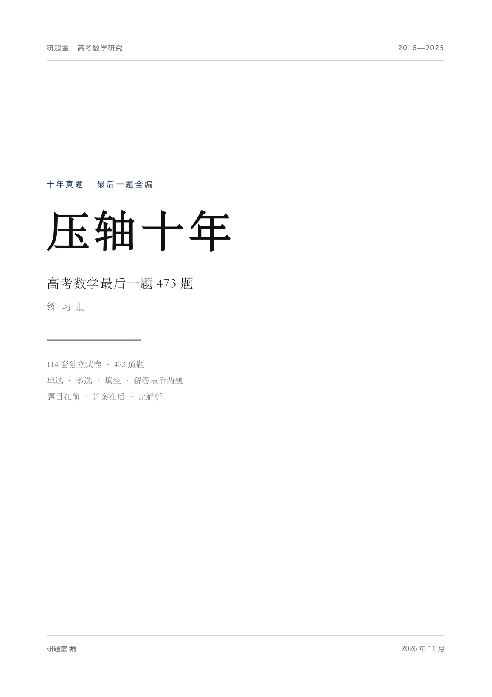
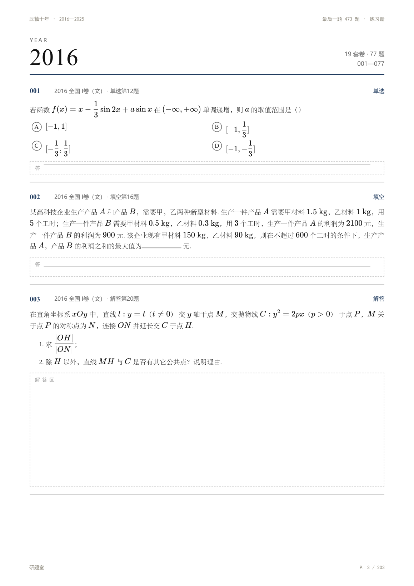
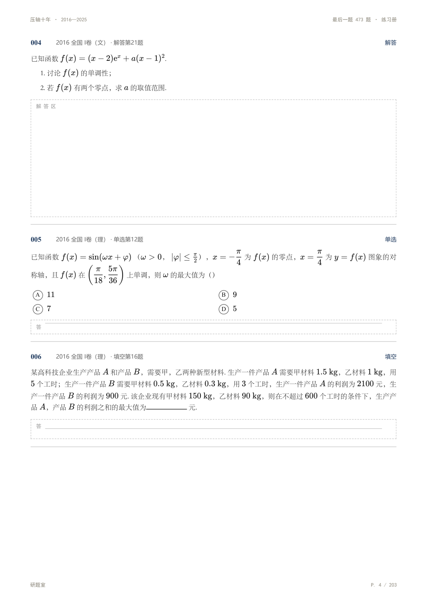
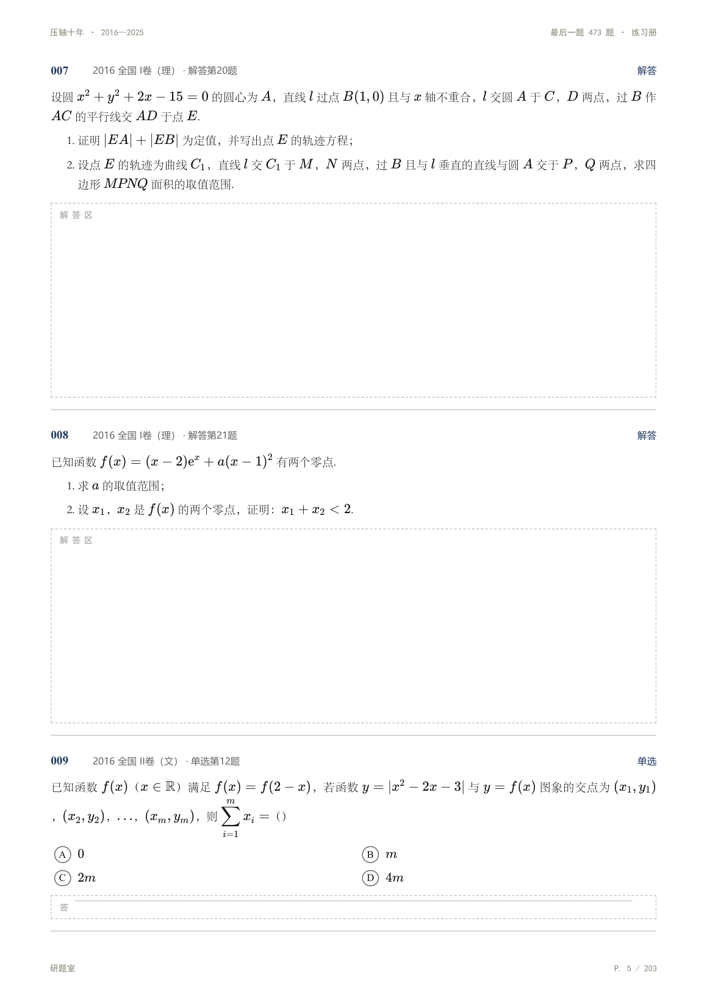
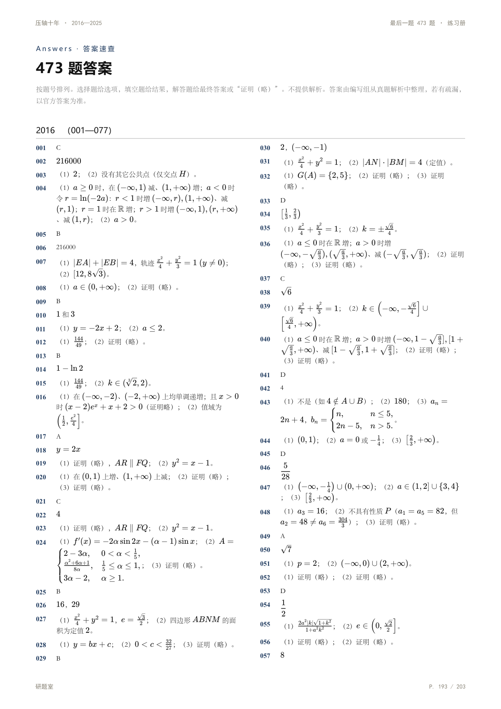

# 压轴十年 · 高考数学最后一题 473 题（练习册）

2016—2025 年高考数学“最后一题”全编：**114 套独立试卷、473 道题**。  
题目在前，答案在后，**不提供解析**。

## 成品

- **PDF：** [`压轴十年_全编练习册.pdf`](压轴十年_全编练习册.pdf)
- **页数：** A4，204 页
- **题量：** 473 道
- **答案：** 书末“答案速查”，473 题全覆盖
- **设计：** 黑白正文＋单色蓝，至多双色；无彩色装饰

## 内容结构

| 部分 | 内容 |
|---|---|
| 前言 | 数据口径、使用方法、编排说明 |
| 十年速览 | 473 道题的题型结构、位置分布、三个变化 |
| 编排表 | 2016—2025 年试卷数、题数、各题型数量、题号范围 |
| 题目 | 按“年份 → 卷别 → 题号”排列，共 473 题 |
| 答案速查 | 按题号排列；选择给选项，填空给结果，解答给最终答案或“证明（略）” |

### 题目范围

- **单选最后一题**：109 道
- **多选最后一题**：12 道（仅新高考/新课标卷）
- **填空最后一题**：114 道
- **解答题最后两题**：238 道（含江苏理科附加题最后两题）

合计 **473 道**。

## 统计口径

- 2016—2025 年普通高考数学，不含上海春考、副题、预赛。
- 文理分卷按两套独立试卷计；同一套卷多省使用只计 1 次。
- “最后一题”= 单选最后一题 + 多选最后一题 + 填空最后一题 + 解答题必考部分最后两题。
- 全国卷 22/23 的二选一选考题不计入。
- 江苏理科附加题单列，故江苏卷每年收录 5 题（填空末题、数学 I 最后两题、附加题最后两题）。

## 编排顺序

1. 按年份：2016 → 2025。
2. 每一年先全国卷，再自主命题卷。
3. 文理分卷先文后理。
4. 同一套卷内：单选 → 多选 → 填空 → 解答 → 附加。
5. 全书题号连续编号 001—473，答案页使用同一编号。

## 使用建议

- **按年刷**：一年一清，选填控制在 8—12 分钟，解答题写完整过程。
- **按卷刷**：只做全国卷或只做自主命题卷，比较不同命题风格。
- **按位置刷**：先攻 235 道选填末题，再攻 238 道解答末题。
- **对答案**：翻到书末“答案速查”；证明题只标“证明（略）”，解答题只给最终结果。

## 预览

| 年份页 | 题目页 |
|---|---|
|  |  |

| 解答题页 | 答案页 |
|---|---|
|  |  |

## 题目来源与版权

题目选自 2016—2025 年公开高考真题，仅用于教学研究与学习交流；题目版权归命题方所有。答案由编写组从真题解析中整理，若有疏漏，以官方答案为准。

题库整理参考：

- [deekur/gaokaomath](https://github.com/deekur/gaokaomath)
- [DxAThing/Gaokao-Math-Problems-Compilation](https://github.com/DxAThing/Gaokao-Math-Problems-Compilation)（CC BY-SA 4.0）

详见 [NOTICE.md](NOTICE.md)。
